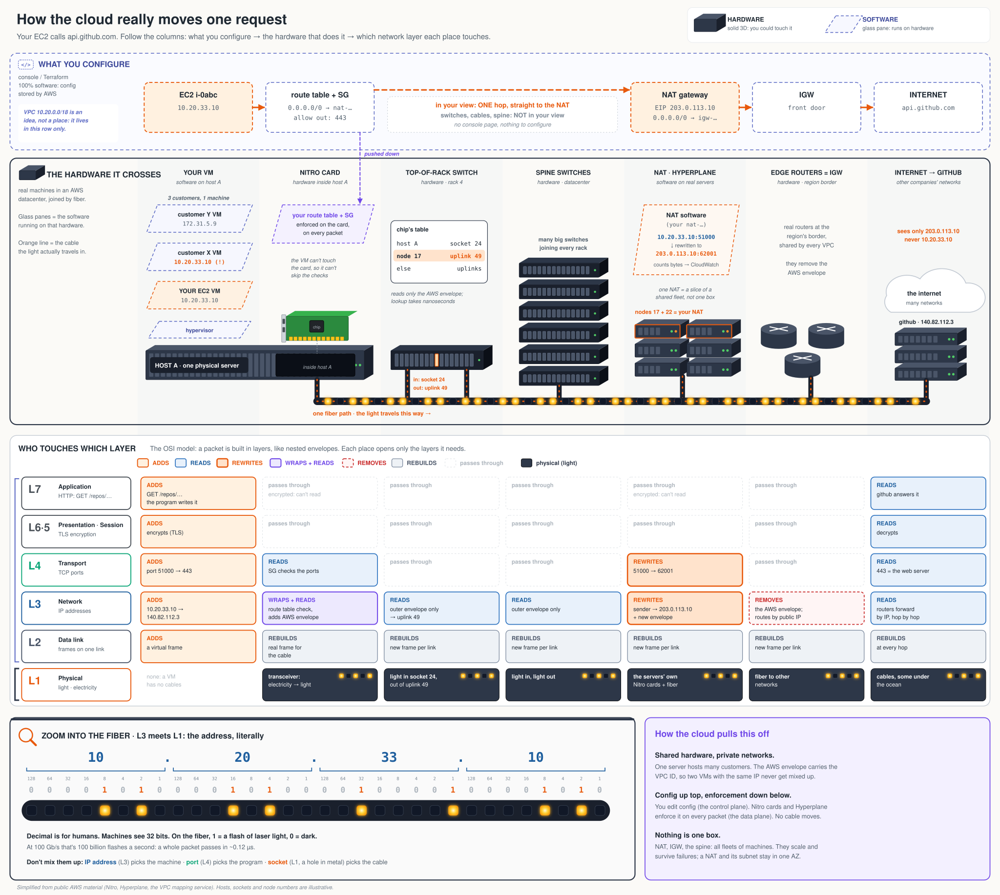
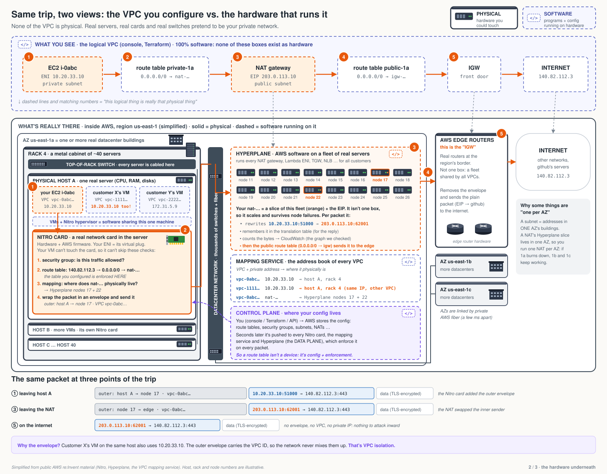
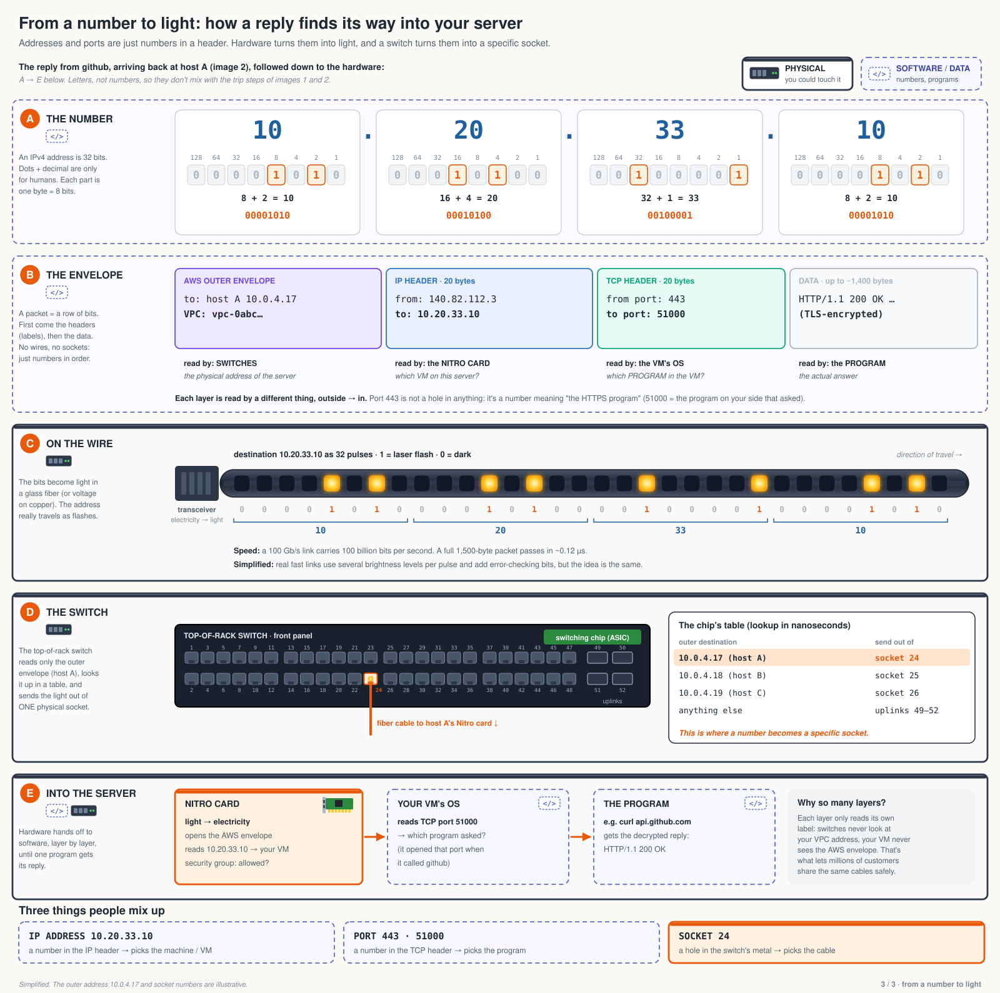
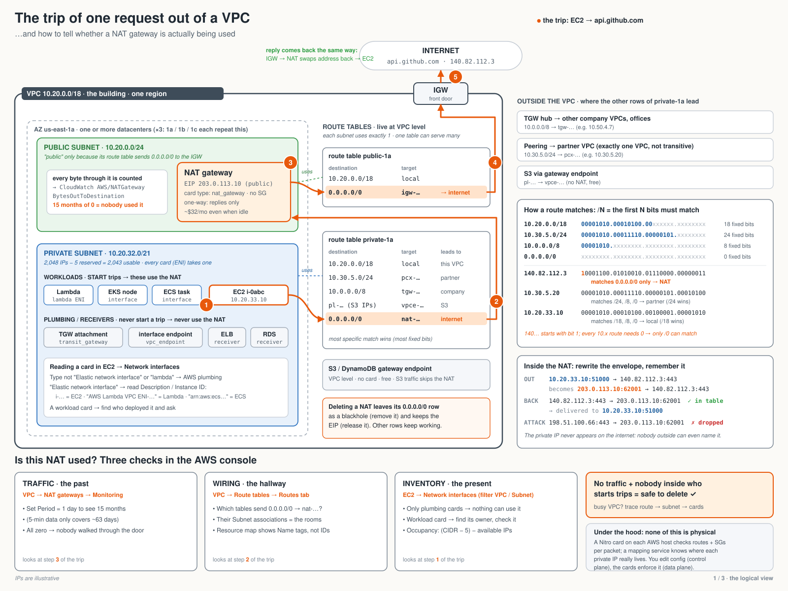

In the console, a VPC is a few boxes and arrows. You click "create", and a private network appears in seconds. Nobody runs a cable and nobody racks a switch. So what actually happened?

The short answer: **nothing physical changed.** The cloud is real servers, real network cards and real switches, shared by many customers, pretending to be your private network. Everything you configure is data, and the hardware enforces it on every packet.

I worked this out while cleaning up some idle NAT gateways. The best way I found to see it is to follow one request, an EC2 instance calling `api.github.com`, and look at it three ways at once.

Read the diagram top to bottom:

1. **What you configure.** In your view, the request makes one hop straight to the NAT.
2. **The hardware it crosses.** In reality it goes through a network card, a rack switch, the datacenter spine, a fleet of NAT servers and the edge routers.
3. **Who touches which layer.** Each place opens only the part of the packet it needs.
4. **The fiber.** At the bottom, an address is just 32 flashes of laser light.

## 1. What you configure: the logical view

These are the pieces you see in the console or in Terraform. None of them is a physical device.

- **VPC:** your private network, defined by IP ranges (CIDRs), in one region. In the diagram, `10.20.0.0/18`.
- **Subnet:** a slice of the VPC's range that lives in **exactly one** Availability Zone (one or more datacenters).
- **Route table:** "traffic for X goes to Y". Each subnet uses one. **The most specific match wins**, so `0.0.0.0/0` is the "everything else" fallback.
- **Security group:** "is this traffic allowed?", checked per network interface.
- **NAT gateway:** lets private servers reach the internet, outbound only. It holds a fixed public IP (an **Elastic IP**).
- **IGW (Internet Gateway):** the VPC's front door to the internet.

A subnet is "public" **only** because its route table sends `0.0.0.0/0` to the IGW. There's no checkbox for it. That's the first hint that all of this is just rules.

A private subnet's route table might look like this:

| Destination | Target | Meaning |
|---|---|---|
| `10.20.0.0/18` | local | inside the VPC |
| `10.0.0.0/8` | Transit Gateway | other company networks |
| `10.30.5.0/24` | peering | one partner VPC (more specific than `10/8`, so it wins) |
| `pl-…` | gateway endpoint | S3 / DynamoDB, skipping the NAT |
| `0.0.0.0/0` | NAT | everything else = the internet |

Our request goes to `140.82.112.3` (GitHub). Only `0.0.0.0/0` matches, so it goes to the NAT. The NAT swaps the private sender `10.20.33.10` for its public IP and remembers the swap, so the reply can find its way back. Nobody on the internet can start a connection inward: the NAT only forwards packets that match a swap it remembers.

## 2. The hardware it crosses: the physical view

Now the same trip on the real machines.

- **Your VM is software.** It shares one physical server with other customers' VMs. One of them may even use the same IP, `10.20.33.10`.
- **A Nitro card** in that server is where your config really lives. It checks your security group and route table on every packet. Your VM can't touch the card, so it can't skip the checks.
- **A mapping service** knows where every private IP physically is: which VPC, which host, which rack. The card wraps your packet in an outer envelope addressed to that place, with your VPC ID on it.
- **The switches** (top-of-rack, then the spine) read only that outer envelope. They never see your VPC's addresses.
- **Your NAT gateway isn't one box.** It's a slice of a shared fleet (AWS calls it Hyperplane). That's why it scales and survives a server dying.
- **The edge routers** are the IGW. They remove the AWS envelope and send the plain packet out to other networks.

The outer envelope carries the VPC ID, so two customers with the same IP on the same host never get mixed up. That's VPC isolation.

## 3. Who touches which layer

A packet is built in layers, like nested envelopes (the OSI model). Your program writes the HTTP request, TLS encrypts it, TCP adds ports, IP adds addresses, and the network card turns it into frames and light.

The grid in the first diagram shows that **each place opens only the layers it needs**:

- The Nitro card reads ports and addresses, then adds the AWS envelope.
- The switches read only the outer envelope.
- The NAT rewrites the sender address and port.
- The edge removes the envelope.
- Only GitHub, at the far end, can decrypt and read the request.

Nobody in the middle can read your data. It's encrypted, and they don't need it.

## 4. From a number to light

At the very bottom, `10.20.33.10` is 32 bits. On the fiber, 1 is a flash of laser light and 0 is dark. A top-of-rack switch looks up the outer address in a table and sends the light out of one physical socket.

Three things people mix up:

- the **IP address** picks the machine
- the **port** picks the program
- the physical **socket** (a hole in the switch's metal, which network engineers also call a port) picks the cable

## How the cloud pulls this off

- **Shared hardware, private networks.** One server hosts many customers. The envelope keeps them apart.
- **Config up top, enforcement down below.** You edit config (the *control plane*). AWS pushes it to every Nitro card, the mapping service and Hyperplane (the *data plane*), which enforce it on every packet. No cable moves.
- **Nothing is one box.** NAT, IGW and the spine are all fleets of machines. They scale and survive failures, and a NAT and its subnet stay in one AZ, so a failure in one AZ stays in that AZ.

## Where this came from: is this NAT gateway used?

This started as a practical question. A cost check flagged some NAT gateways as idle (each costs about $32 a month even when unused), and I had to decide whether deleting them was safe. Knowing how the trip works turns that into three checks:

1. **Traffic, the past.** VPC → NAT gateways → Monitoring. Set the period to 1 day to see 15 months of data. All zero means nobody walked through the door.
2. **Wiring, the hallway.** VPC → Route tables. Which tables send `0.0.0.0/0` to this NAT, and which subnets use those tables?
3. **Inventory, the present.** EC2 → Network interfaces, filtered by VPC. Plumbing (TGW attachments, endpoints, load balancers, databases) never starts trips out. Workloads (EC2, EKS nodes, ECS tasks, Lambda) do: find their owner and ask.

No traffic and nobody inside who starts trips means it's safe to delete. Two things don't go away with it: its `0.0.0.0/0` routes stay as **blackholes** (remove them), and its Elastic IP stays allocated and keeps billing (release it).

---

The diagrams are simplified from public AWS material (Nitro, Hyperplane, the VPC mapping service). IPs, hosts, racks and node numbers are illustrative. One simplification to know: strictly, the NAT gateway rewrites the source to its own *private* IP, and the IGW maps that to the Elastic IP. The diagrams show both as one step.
